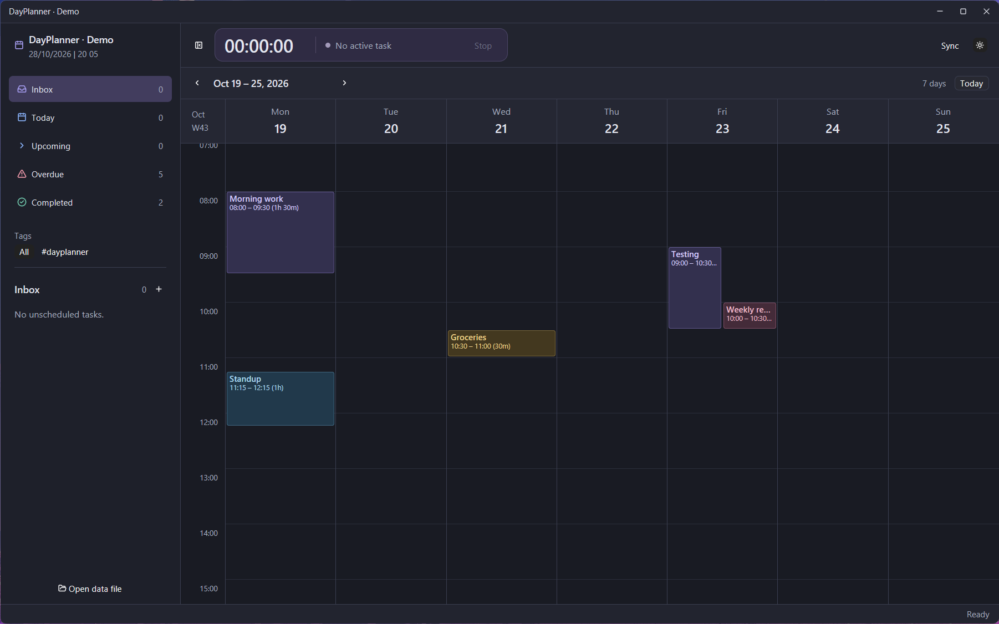

# DayPlanner

A minimal native Rust/GPUI day planner.



## Features
- Tasks
  - Notes
  - Task grouping
  - Tags
  - Sub-tasks
- Calendar view
  - Overlaping blocks
  - Drag'n'drop tasks from sidebar
- Time tracker
- Todoist sync via API
- Light/dark theme

## Run

Install Rust through rustup. The project selects Rust 1.97.1 automatically. GPUI Component 0.7.1 and its matching GPUI snapshot are pinned in `Cargo.lock`.

```sh
cargo run --locked
```

To use the separate demo database:

```sh
cargo run --locked -- --demo
```

Demo mode is labeled in the window and sidebar. It seeds a small dataset when creating the demo database, then preserves your edits and deletions on subsequent launches. It opens the Inbox group and the saved demo week. A fresh demo contains three incomplete tasks, four calendar blocks, and the completed Weekly review task.

After rebuilding, close any previously running planner and launch again to load the new application code. Launching the `.exe` without `--demo` opens normal mode, whose task list is initially empty.

Normal data lives in `%LOCALAPPDATA%/DayPlanner/dayplanner.sqlite3` on Windows and `${XDG_DATA_HOME:-~/.local/share}/dayplanner/dayplanner.sqlite3` on Linux. Demo mode uses `dayplanner-demo.sqlite3` in the same directory. SQLite is bundled; the application does not need a separate SQLite installation.

The theme choice is saved in a small configuration file, `%APPDATA%/DayPlanner/theme` on Windows or `${XDG_CONFIG_HOME:-~/.config}/dayplanner/theme` on Linux. Light mode is the initial default; normal and demo mode share the appearance preference.

### Windows

Use the MSVC Rust target, Visual Studio C++ Build Tools, and the Windows 10/11 SDK (including the `fxc` shader compiler). If build tools are not detected, run Cargo from the Visual Studio developer PowerShell.

After building, launch `target/debug/dayplanner.exe` directly. Closing the last window stops and saves any active timer before exiting. If a save is in progress, the window waits for its result before closing; a failed save keeps the window open with an error so you can retry.

### Linux (Fedora)

Install the native build dependencies and a working Vulkan graphics driver:

```sh
sudo dnf install gcc gcc-c++ clang cmake make pkgconf-pkg-config \
  fontconfig-devel freetype-devel libX11-devel libxcb-devel \
  libxkbcommon-devel libxkbcommon-x11-devel wayland-devel \
  openssl-devel libzstd-devel vulkan-loader dbus-devel
cargo run --locked
```

Wayland and X11 are enabled in the GPUI platform dependency. Run normally in a Wayland session; to check X11/XWayland, run:

```sh
WAYLAND_DISPLAY='' cargo run --locked
```

Testing on Linux has not been verified yet.

# Work in Progress

This is still a project mainly intended for personal use, as such it may contain bugs and not work on certain evnironments.
